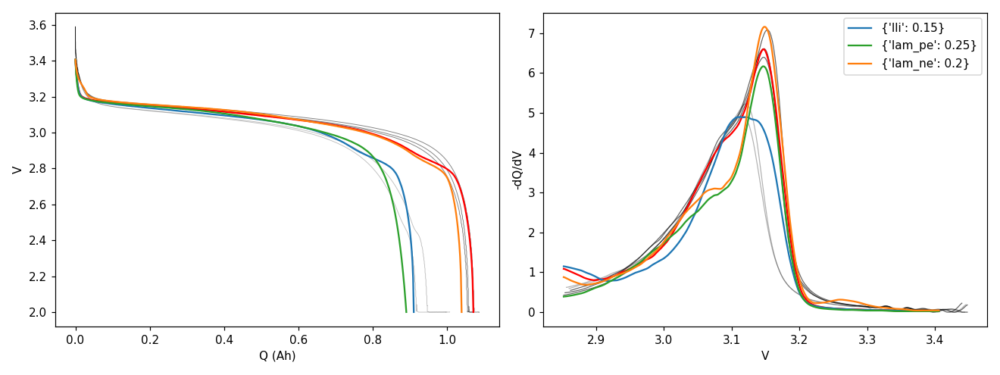
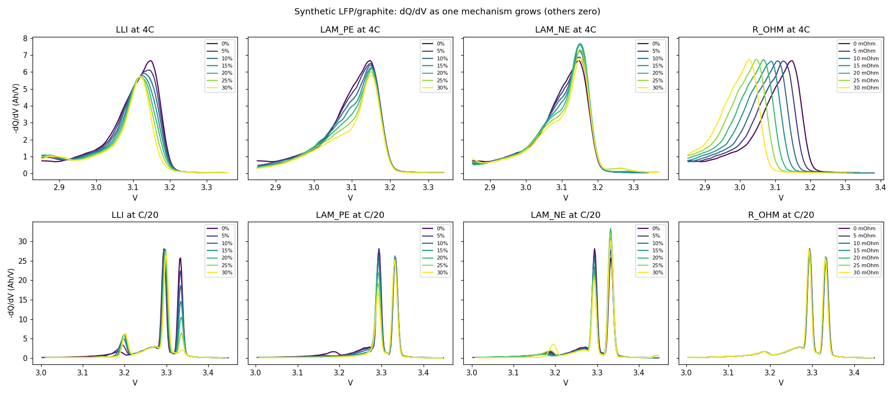
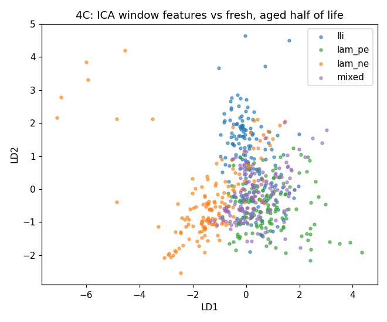

# Phase 2: synthetic validation set

There is no teardown data for the public cells, so `oracle/synth.py` provides the ground truth. It is a half-cell model of an A123-like LFP/graphite 18650 where we set exactly how much LLI, LAM_PE and LAM_NE a cell has, and it returns a `DischargeCurve` in the same format as the real loaders.

## Model

- **Graphite:** MSMR open-circuit potential (Verbrugge et al. 2017, six staging galleries).
- **LFP:** a flat MSMR plateau at 3.42 V plus the steep end terms from Prada et al. (2013).
- **Balance:** cyclable lithium is conserved. The cell is charged to 3.6 V, then discharged at constant current to 2.0 V.
- **Mechanisms:** LLI removes lithium. LAM_PE and LAM_NE shrink each electrode's capacity. `r_ohm` adds series resistance. A LAM_NE large enough to overfill the graphite plates the extra lithium, the way a real cell would.
- **4C kinetics:** a resistance that changes with depth of discharge as a cubic (it falls as the cell self-heats, then rises at the end through solid diffusion), plus a skewed spread of local overpotentials (a Gaussian with a one-sided exponential tail). All of these were fitted by Nelder-Mead to the mean of 24 real Severson cells at cycle 10: their dQ/dV, V(Q), peak position, width and capacity.



Black lines are real Severson cells at cycle 10; light grey lines are the same cells at cycle 400. Red is the fresh model. It matches the real cells' capacity (1.071 Ah) and its peak sits at the same 3.148 V with the same width (FWHM 0.110 V, within 1 mV). dQ/dV RMSE is 0.14 Ah/V on a 6.5 Ah/V peak, down from 0.74 in the first calibration. V(Q) is off by up to about 0.1 V in the last 10 % of discharge. The real cycle-400 curves lose their high-voltage side the way the model's LLI curve does. That is only a visual comparison so far, not a fit.

## What each mechanism does to dQ/dV



| Mechanism | C/20 (graphite staging peaks visible) | Severson 4C (one merged peak) |
|---|---|---|
| LLI | The **highest-voltage peak (~3.34 V) disappears**, because graphite is never fully lithiated. The other peaks stay. | The whole peak shrinks, most of all on its high-voltage side |
| LAM_PE | Hidden at first, because LFP has about 10 % spare capacity. Then the **lowest-voltage peak (~3.19 V) is cut** because LFP fills up early. | The low-voltage side shrinks |
| LAM_NE | The **middle peak (~3.29 V) shrinks** and the peaks squeeze together | The low-voltage side shrinks a little and the high-voltage side grows a little |
| Resistance | Almost nothing changes at C/20 | **The whole peak shifts to lower voltage** and keeps its area |

This contradicts the current heuristics in `features.py` and `mechanisms.py`, which assume LLI shrinks all peaks together.

## Can the features tell the mechanisms apart?

The labelled dataset has 100 cells: 25 LLI-dominant, 25 LAM_PE-dominant, 25 LAM_NE-dominant and 25 mixed. Each cell has manufacturing scatter and 11 snapshots over 1000 cycles. Each snapshot goes through the project's own `compute_ica` and `extract_peaks`, plus capacity in fixed voltage bands. The table scores the aged half of life (600 curves). Cross-validation is grouped by cell, so the model is never tested on a cell it was trained on.

| Rate | Features | LDA accuracy (4 classes) | GMM clusters ARI | R² for LLI / LAM_PE / LAM_NE |
|---|---|---|---|---|
| 4C | change from the cell's own fresh curve | 0.94 | 0.28 | 0.93 / 0.89 / 0.84 |
| 4C | single test, no fresh reference | 0.90 | 0.34 | 0.84 / 0.84 / 0.49 |
| C/20 | change from fresh | 0.94 | 0.61 | 0.96 / 0.99 / 0.90 |
| C/20 | single test, no fresh reference | 0.93 | 0.72 | 0.94 / 0.97 / 0.89 |



**Takeaways**

1. The features do carry the mechanism. A supervised model separates the three pure mechanisms well even at 4C.
2. At 4C, unsupervised clustering finds the mechanisms only partly (ARI 0.28), and a single test without a fresh reference loses much of the LAM_NE signal (R² 0.49). At C/20 a single test works almost as well as having the cell's history. The second-life grading station should therefore use a slow partial discharge (C/20 to C/5) if it can.
3. The partial-discharge window has to cover the low-voltage side of the peak, because that is where LAM_PE shows. At 4C the fresh peak sits at 3.15 V with a long low-voltage tail, so the default ICA window of 3.00 to 3.45 V loses part of it. `synth_check.py` uses 2.85 to 3.40 V for 4C.

## Update: C/25 calibration and kinetic ageing

**C/25 shape.** I fitted the graphite staging widths and spacing, the LFP plateau slope and the rest spread to the C/25 discharge of Wheeler et al. (2025) cell 6a at checkup 0. That is the same A123 cell, tested at 50 degC. The model's three peaks now sit within 1 mV of the real ones (3.335/3.297/3.197 V against 3.334/3.296/3.196 V). The top two peaks are 10 and 11 mV wide, against 10 and 9 mV real; before this fit the model gave 22 to 24 mV. Their heights are 17.3 and 35.3 Ah/V, against 15.7 and 35.9. After that I refitted the 4C kinetics and the electrode balance on top of the new shape. The 4C peak position now matches Severson within 1 mV and its width within 3 mV, with a dQ/dV RMSE of 0.29 Ah/V. Both datasets put the cyclable lithium close to the LFP capacity, so LFP is nearly the limiting electrode. That means even a small LAM_PE now costs capacity right away, while LAM_NE stays hidden at first.

**Kinetic ageing.** Aged real Severson cells do something the earlier model couldn't: their peak slides to lower voltage and loses height but keeps its sharp high-voltage edge. Two new ageing parameters cover this. `r_diff` is a resistance that grows through the discharge. `het` widens the spread of local overpotentials. I fitted the model to real cells at 95 to 78 % capacity. With these parameters the fit error was 25 to 40 % lower than without them. `r_diff` reached 0.02 to 0.13 ohm, and `het` stayed small (0 to 0.2), so a growing spread alone is not what the real cells show. `generate_dataset` now adds both to every synthetic cell as nuisance ageing, with defaults `r_diff_range=(0, 0.15)` and `het_range=(0, 0.25)`.

**Effect on separation.** The features still carry the mechanisms once that nuisance is in the data, but only a nonlinear model can recover them at 4C. Grouped-CV R² for the aged half of life:

| Rate | Model | LLI | LAM_PE | LAM_NE | r_diff |
|---|---|---|---|---|---|
| 4C | random forest, single test | 0.71 | 0.85 | 0.58 | 0.97 |
| 4C | linear ridge, single test | 0.27 | 0.71 | 0.46 | |
| C/20 | random forest, single test | 0.93 | 0.97 | 0.90 | 0.79 |

At 4C the kinetic loss is the easiest thing to read, and LLI and LAM_NE are the hardest. At C/20 the kinetic ageing hardly matters. A grading station that can run a slow partial discharge will read the mechanisms much more reliably.

**Start-of-discharge relaxation and coverage check.** Real 4C discharges hold more capacity above 3.2 V (0.036 Ah against 0.015 Ah in the model), because their overpotential takes about 25 mAh to build up. I added that as a relaxing resistance (`r_rc`, `q_rc`) fitted to the Severson cells. Then I checked coverage. I computed the band features of 511 real Severson snapshots (48 cells, every 50 cycles) and counted how many sit farther from the synthetic cloud than 99 % of synthetic curves do from other synthetic cells (5 nearest neighbours, standardised). The synthetic cloud was built the way the grading thread builds it, with profile ranges stretched 1.6x and r_growth 0.02.

| Real capacity | Outside the synthetic cloud before | After |
|---|---|---|
| above 95 % | 100 % | 0 % |
| 90 to 95 % | 100 % | 0 % |
| 85 to 90 % | 100 % | 2 % |
| below 85 % | 100 % | 0 % |

## How to use it

```python
from oracle import synth
curve = synth.generate(lli=0.10, lam_pe=0.05, c_rate=4/1.1)           # one DischargeCurve
curve = synth.generate(lam_ne=0.2, c_rate=0.05, window=(3.45, 3.0))   # partial C/20 discharge
curves, labels = synth.generate_dataset(n_cells_per_profile=25)       # labelled ageing set
curves, labels = synth.load_dataset("data/processed/synth/synth_4C")  # prebuilt set
```

Rebuild the sets, figures and scores with `python -m oracle.synth_check --out data/processed/synth`, which takes about a minute. Run the tests with `pytest tests/test_synth.py`.
